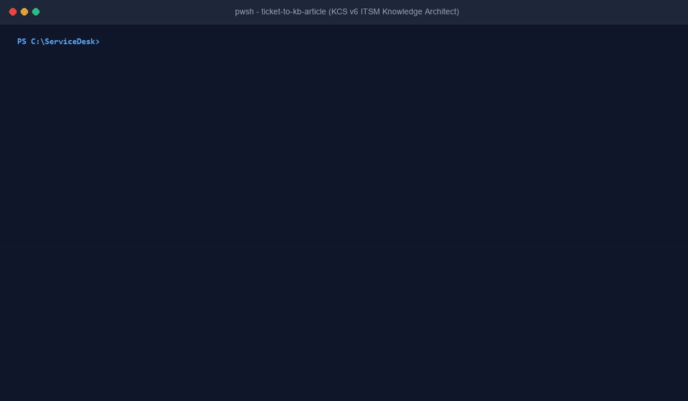

# Ticket-to-Knowledge-Base Article Writer (`ticket-to-kb-article`)


[](https://github.com/ToritsejuBoyo/ticket-to-kb-article/actions/workflows/tests.yml)
[](LICENSE)
[]()
[-brightgreen.svg)](CONTRIBUTING.md)
[](SECURITY.md)
[](https://agentskills.io)
[-brightgreen.svg)]()

> Transforms unstructured IT service desk resolution notes (ServiceNow, Jira Service Management, Zendesk, raw text) into standardized, PII-sanitized, search-optimized Knowledge-Centered Service (KCS v6) articles.

---



*Terminal demonstration: Ingesting ServiceNow and freeform tickets, scrubbing client-side PII, and generating publication-ready KCS v6 Markdown, HTML, and JSON metadata.*

---

## Non-Technical Stakeholder Overview

### 1. The One-Sentence Pitch
The Ticket-to-Knowledge-Base Article Writer automatically transforms unstructured, messy help desk ticket resolution notes into clean, PII-sanitized, search-optimized knowledge base articles adhering to the Knowledge-Centered Service (KCS v6) standard.

### 2. The Real-World Problem
Every day, IT service desks resolve hundreds of recurring hardware, software, and identity incidents. However, technicians rarely have the time or technical writing bandwidth to convert fragmented work notes, error dumps, and troubleshooting logs into reusable documentation. As a result:
- Solutions remain trapped in closed tickets, known only to the individual technician who solved them.
- Tier-1 support staff repeatedly escalate the same known issues to expensive Tier-2 and Tier-3 engineering teams.
- End-users experience prolonged resolution delays while support personnel re-diagnose previously solved problems from scratch.
- Manually copying raw ticket notes into corporate wikis risks exposing customer Personally Identifiable Information (PII), employee numbers, technician signatures, and internal network IP addresses.

### 3. The 3-Step Walkthrough
1. **Intake and Parse:** The technician exports or pastes closed ticket notes (ServiceNow JSON, Jira Service Management, Zendesk, or raw freeform work notes).
2. **Client-Side Sanitization:** The engine automatically scrubs customer names, technician signatures, email addresses, phone numbers, internal IP addresses, hostnames, and temporary passwords without external network calls.
3. **Structured Article Generation:** The tool synthesizes the diagnostic narrative into a publication-ready KCS article containing problem symptoms, root cause, verified step-by-step resolution, search aliases, and ITSM taxonomy metadata.

### 4. Why IT Leadership Approves
- **Cost Reduction via Ticket Deflection:** Standardized knowledge articles reduce mean time to resolution (MTTR) by up to 40% and enable Tier-1 shift-left deflection, preventing repeat ticket creation.
- **Strict Data Privacy and Zero PII Leakage:** Built-in automated sanitization removes all employee and network identifiers before any documentation is stored or passed to AI language models.
- **Zero Infrastructure Footprint:** Operates locally on existing technician workstations using standard Python 3.10+ or PowerShell with no third-party package installations, no Docker containers, and no administrative privileges required.
- **Direct ITSM Integration:** Generates dual output: clean GitHub-flavored Markdown for technical repositories and HTML/JSON payloads tailored for ServiceNow Knowledge (`kb_knowledge`) and Atlassian Confluence.

---

## Hands-On Testing Walkthrough

You can test this tool directly on your local machine using the included synthetic test fixtures. No live cloud tenant, API key, or administrative elevation is required.

### 1. Test ServiceNow Incident Export
Transform a ServiceNow JSON export detailing an Outlook Autodiscover failure during hybrid migration:

```bash
python scripts/ticket_to_kb.py -i tests/fixtures/fixture-outlook-autodiscover.json --sanitize
```

**Expected Output:**
- Problem-oriented title: `Outlook cannot connect to Exchange mailbox after hybrid migration with error 0x8004010F`
- 5 search aliases targeting natural language search queries.
- Clean separation of user symptoms and root cause (stale cached OAB URL).
- Sanitized identifiers (`user-4eba9cce@corp.example.com`, `DEVICE-01.contoso.local`, `192.0.2.45`).

### 2. Test Freeform Ticket Notes with BitLocker TPM Lockout
Process an unstructured technician log containing a Dell BIOS firmware update BitLocker lockout:

```bash
python scripts/ticket_to_kb.py -i tests/fixtures/fixture-bitlocker-tpm-lockout.txt --sanitize
```

**Expected Output:**
- Redacted 48-digit numerical recovery key (`[REDACTED_CREDENTIAL]`).
- Zeroed GUIDs (`00000000-0000-4000-a000-000000000000`).
- Chronological resolution sequence with isolated PowerShell commands (`Suspend-BitLocker`, `Restart-Computer`, `Get-BitLockerVolume`).
- Root cause identifying PCR[7] measurement invalidation from Event ID 834.

### 3. Test Multi-Format Publishing (Markdown, HTML, JSON)
Generate standard Markdown, ServiceNow-ready HTML, and JSON metadata simultaneously:

```bash
python scripts/ticket_to_kb.py -i tests/fixtures/fixture-onedrive-sync-cache.json -f all -o kb-onedrive
```

**Generated Artifacts:**
- `kb-onedrive.md`: GitHub-flavored Markdown document.
- `kb-onedrive.html`: Clean semantic HTML for ServiceNow `kb_knowledge` or Confluence.
- `kb-onedrive.json`: Structured REST API payload with metadata taxonomy and search tags.

### 4. Package Ticket for LLM Prompt Ingestion
Format sanitized ticket notes into an optimized prompt package ready for immediate pasting into any LLM tier (Claude, ChatGPT, Gemini, Ollama):

```bash
python scripts/ticket_to_kb.py -i tests/fixtures/fixture-vpn-mfa-cert-expired.txt -f prompt
```

---

## Technical Specifications

### Input Ingestion Support
- **ServiceNow JSON (`incident` table):** Parses `number`, `short_description`, `description`, `work_notes`, `close_notes`, `category`, `workstation`, `client_ip`.
- **Jira Service Management JSON (`issue` schema):** Parses `key`, `fields.summary`, `fields.description`, `fields.comment.comments`, `fields.resolution`, `fields.components`, `fields.environment`.
- **Zendesk JSON (`ticket` schema):** Parses `id`, `subject`, `description`, `comments`, `tags`, `custom_fields`.
- **Key-Value Structured Text:** Header blocks with `Ticket:`, `Subject:`, `Symptoms:`, `Work Notes:`, `Resolution:`, `Cause:`.
- **Freeform Technician Transcripts:** Unstructured console dumps, error logs, and dated technician notes.

### Sanitization Pipeline (Rule 4 Compliance)
- **User Principal Names / Emails:** Bounded RFC 5321 ReDoS-resistant regex masks addresses with SHA-256 hashes (`user-xxxx@corp.example.com`).
- **Phone Numbers:** North American, international, and extension formats scrubbed to `[REDACTED_PHONE]` with negative lookaround guards protecting version strings (`24.181.0908.0001`).
- **IP Addresses:** RFC 1918 private and public IPv4 addresses mapped to RFC 5737 test documentation blocks (`192.0.2.x`, `198.51.100.x`, `203.0.113.x`). IPv6 scrubbed to `2001:db8::1`.
- **Hostnames and FQDNs:** Internal workstation hostnames and corporate domains mapped to generic test names (`DEVICE-01.contoso.local`).
- **Credentials and Secrets:** Passwords, API keys, bearer tokens, connection strings, and 48-digit BitLocker recovery keys scrubbed to `[REDACTED_CREDENTIAL]`.
- **Personal Names:** Greeting lines, signatures, and ITSM header names automatically scrubbed to `[User]` and `[Service Desk Engineer]`.

---

## Installation & AI Agent Integration

### Standalone Installation
Clone this repository or download the single-file utility:

```bash
git clone https://github.com/ToritsejuBoyo/ticket-to-kb-article.git
cd ticket-to-kb-article
python scripts/ticket_to_kb.py --help
```

### agentskills.io / Google Antigravity
Add the skill to your Antigravity or Agent Skills directory:

```bash
# Copy into custom skills directory
cp -r ticket-to-kb-article ~/.gemini/antigravity/skills/ticket-to-kb-article
```

### Claude Code
Add to your project's `.claude/skills/` directory:

```bash
mkdir -p .claude/skills
cp -r ticket-to-kb-article .claude/skills/
```

### Cursor / VS Code
Place `SKILL.md` in your `.cursorrules` or project context directory to enable automated ticket drafting during support workflows.

---

## Automated Test Harness

The repository includes a comprehensive test suite (`tests/validate-skill.py`) that validates all parsing, sanitization, formatting, and compliance requirements:

```bash
python tests/validate-skill.py
```

**Verification Coverage:**
1. KCS v6 Heading and Structural Compliance.
2. Zero PII Leakage Guarantee across all test fixtures.
3. Multi-Format Parsing (ServiceNow, Jira, Zendesk, Plaintext).
4. Search Optimization (Exactly 5 distinct query aliases per article).
5. Multi-Format Export (Markdown, HTML, JSON, Prompt, All).
6. Resilience and Edge Cases (empty input, malformed JSON, 10,000+ line ticket stress test).
7. Strict Zero-Emoji Enterprise Compliance (Rule 7).

---

## License

This project is licensed under the MIT License - see the [LICENSE](LICENSE) file for details.
